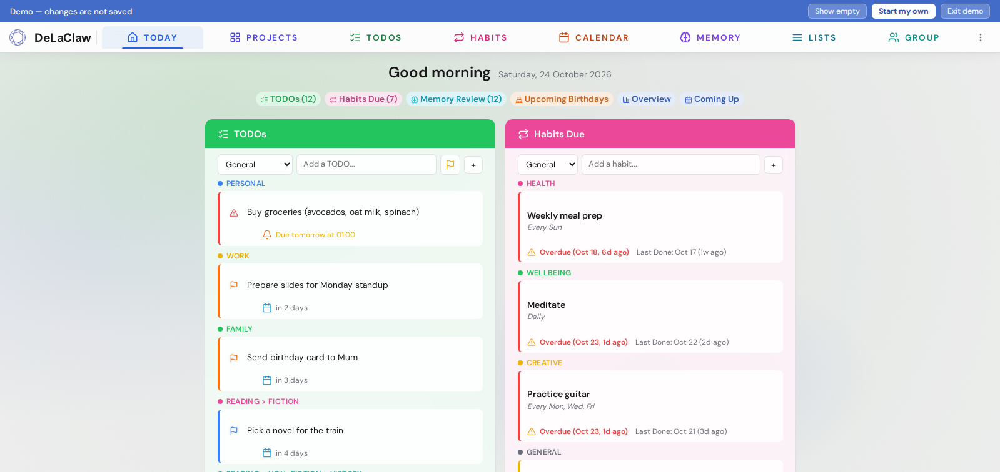
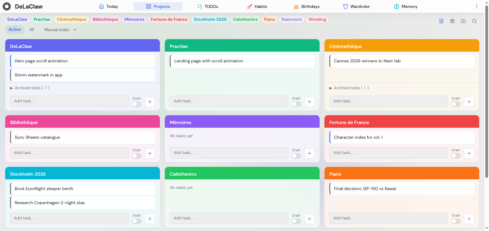

# DeLaClaw

A personal life OS that runs in the browser. Your data lives in your Google Drive — no account, no server, no SaaS.

[](https://github.com/AntGro/DeLaClaw/actions/workflows/test.yml)
[](LICENSE)
[](https://delaclaw.com)

<p align="center">
  
</p>

## What it does

DeLaClaw is a single-page productivity dashboard that runs entirely in the browser. Sign in with Google and your data is stored as JSON files in your own Google Drive — your personal files are never accessed. No API keys, no database, no backend to maintain.

### Modules

| Module | Description |
|---|---|
| **Today** | Daily briefing: focus TODOs, due habits, flashcard reviews, upcoming birthdays, stats |
| **Projects** | Kanban-style project boards with task statuses, links, and drag-and-drop |
| **TODOs** | Categorized tasks with 5 priority levels, due dates, snooze, drag-and-drop reordering |
| **Habits** | Recurring habits with flexible scheduling (structured rules + free text), completion tracking, streaks |
| **Flashcards** | Spaced repetition (FSRS algorithm) with deck organization and text memorization mode |
| **Calendar** | Month, week, day and year views bringing together TODOs, habits and birthdays, with per-type filters |
| **Lists** | General-purpose checklists with archival support |
| **Group** | [COMING] Sharing-group management: members, invites, shared-item counts |

### Capabilities

- **Google Drive storage**: data saved as per-table JSON files in a `DeLaClaw/` folder in your Drive
- **Google Calendar sync**: optionally mirror habits, TODOs, and birthdays to a dedicated Google Calendar
- **PWA**: installable on mobile and desktop via service worker with network-first caching
- **Dark and light themes** with automatic OS preference detection
- **Internationalization**: English, French, Spanish
- **Drag-and-drop** reordering across all list views
- **Keyboard shortcuts** for common actions
- **Zero frameworks**: vanilla JavaScript with ES modules, no build step

## Screenshots

<p align="center">
  
</p>

## Quick start

### Google Drive

1. Open [delaclaw.com](https://delaclaw.com)
2. Click "Connect with Google"
3. Sign in with your Google account — DeLaClaw creates a `DeLaClaw/` folder in your Drive with one JSON file per table
4. All data syncs automatically; no API keys or database setup needed

### Demo (no setup)

1. Open [delaclaw.com](https://delaclaw.com)
2. Click "Try the demo" and choose a dataset
3. All data lives in memory and resets on refresh

See [docs-site/setup.md](docs-site/setup.md) for detailed instructions.

## Architecture

Single-page application with no build step. The browser loads ES modules directly.

```
index.html              Shell: login gate, tab navigation, all views
style.css               All styles (dark + light themes, responsive)
js/
  main.js               App bootstrap, view switching, settings, footer
  state.js              Centralized state and constants
  db.js                 Adapter abstraction with Proxy-based activity tracking
  adapters/
    demo.js             In-memory adapter with sample data
    drive.js            Google Drive adapter (in-memory + per-table JSON persistence)
    drive-backup-policy.js  Pre-migration backup policy (pure)
    rest.js             Local backend adapter (Bun + SQLite)
    offline-cache.js    IndexedDB cache behind the read-only offline fallback
  calendar.js           Calendar views (month/week/day/year)
  calendar-pure.js      Pure calendar date/expansion logic
  calendar-sync.js      Google Calendar sync
  welcome.js            Today dashboard
  projects.js           Project boards and task management
  todos.js              TODO management
  habits.js             Habit tracking
  frequency-rule.js     Pure habit scheduling rules (next-due computation)
  pending-next-due.js   Per-habit in-flight next-due publish tracking (pure)
  flashcards.js         Flashcard SRS + text memorization
  scene-parse.js        Scene script parsing for text memorization (pure)
  birthdays.js          Birthday views and modals (Calendar and Today)
  lists.js              Checklists
  sections-pure.js      Nested-section tree logic for TODOs, Habits and Lists (pure)
  groups.js             Sharing-group management tab
  sharing.js            Sharing factory (selects the adapter by backend)
  sharing-ui.js         Sharing and group UI
  sharing-drive.js      Drive-backed sharing transport
  sharing-interface.js  Sharing adapter interface
  sharing-envelope.js   Invite-code envelope encoding
  sharing-file-reconcile.js  Sharing file reconciliation engine
  sharing-mutation-queue.js  Queued sharing mutations
  agents-ui.js          Settings > Agents pane
  daily-visits.js       Daily-visit aggregate tracking (pure)
  drive-folders.js      Environment-aware Drive folder names
  import-pure.js        Batch-import parsing helpers (pure)
  todo-import.js        TODO validation for batch import
  habit-import.js       Habit validation for batch import
  batch-import.js       Shared batch-import building blocks
  delegation.js         CSP-safe event delegation
  i18n.js               Translation strings (en/fr/es)
  icons.js              Lucide icon rendering
  utils.js              Shared utilities
  item-utils.js         Drag-and-drop, inline editing
  backend-logos.js      Backend brand icons (SVG)
  hero.js               Landing page animations
  logo.js               Logo animation engine
  storm3d.js            Three.js hero effect
  bootstrap.js          Extracted inline init script (CSP-safe)
  sw-register.js        Service worker registration (CSP-safe)
  version.js            Auto-generated version constant
  demo-chooser.js       Demo dataset selector
  demo-data.js          Sample data for demo mode
sw.js                   Service worker (network-first + precache)
```

The adapter pattern (`db.js`) means the app logic never touches the storage directly. Each adapter exposes the same `.from(table).select()/.insert()/.update()/.delete()` interface.

Category/deck foreign keys use CASCADE on delete — deleting a category deletes its items.

See [docs-site/architecture.md](docs-site/architecture.md) for details.

## Testing

```bash
bun tests/tests.js
```

Tests covering unit logic, adapter compliance, import/export, and structural checks (XSS escaping, generated-index freshness). All tests must pass before pushing to `dev`.

## Contributing

See [Contributing](docs-site/contributing.md).

## License

[PolyForm Noncommercial 1.0.0](LICENSE) — see [NOTICE](NOTICE) for attribution requirements.

DeLaClaw is source-available, not open source. You can use, modify, and distribute it for noncommercial purposes under the terms of the PolyForm Noncommercial License 1.0.0. Commercial use requires a separate license from the copyright holder. Versions released before October 2026 were distributed under AGPL-3.0 and remain available under those terms.

## Third-party

- [Lucide](https://lucide.dev) icons (ISC License)
- [DM Sans](https://fonts.google.com/specimen/DM+Sans) font (Open Font License)
- [Three.js](https://threejs.org) for hero animations (MIT License)

See [Attributions](docs-site/attributions.md) for full details.
